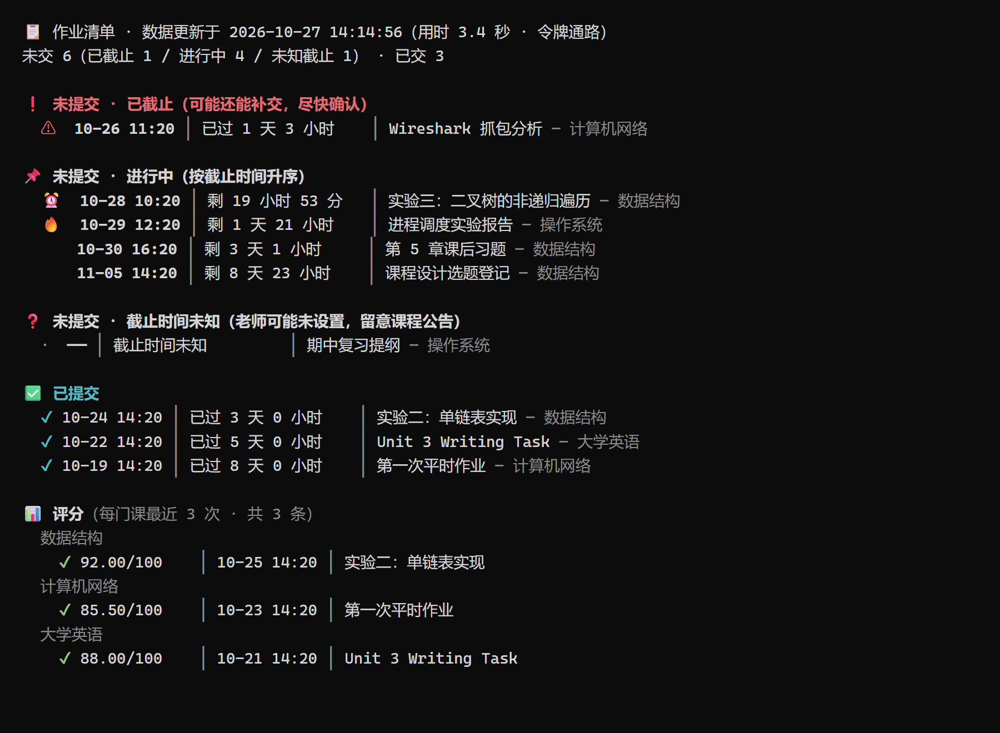

# AssignmentRadar · Moodle 作业雷达

轮询学校 Moodle 平台本学期所有课程，把作业、截止时间、提交状态和评分抓下来存进本地
SQLite，新作业出现 / 截止时间变更 / 临近截止时弹 Windows 通知。**纯命令行工具**，无 GUI 依赖
（托盘和网页面板是可选的）。


> **非官方工具。** 与任何学校、教育机构及其在线教学平台运营方无隶属或合作关系，
> 未获其授权或背书。详见文末[免责声明](#免责声明)。

---

## 它做什么

- **盯**：默认 120 分钟一轮，新作业出现即弹通知（点击直达作业页）
- **催**：截止前 24 小时提醒一次，已交的不打扰，老师改期也会通知
- **存**：老师发的附件按「课程 / 作业」归档，另存一张作业页整页截图

```
📋 作业清单 · 数据更新于 2026-03-14 09:20:36（用时 2.1 秒 · 令牌通路）
未交 12（已截止 1 / 进行中 11） · 已交 8

❗ 未提交 · 已截止（可能还能补交，尽快确认）
      03-12 23:59 │ 已截止 2 天        │ 实验四 列表渲染 — Web 应用开发

📌 未提交 · 进行中（按截止时间升序）
      03-18 00:34 │ 剩 3 天 9 小时     │ 上机实验2提交 — 编译原理与方法
      03-24 23:59 │ 剩 9 天 9 小时     │ 第七周作业 — 计算机网络基础

📊 评分（最近批改）
      87.0/100  │ 03-11 批改 │ 实验三：直方图均衡 — 数字视觉基础
```

<!-- 想放真实截图：把图片放到 docs/images/ 下，然后取消下面两行的注释

-->

---

## 快速开始

**前置**：Windows 10/11 + Python ≥ 3.11（`python --version` 自查；3.10 会在
`import tomllib` 处直接失败）。运行时依赖只有 6 个：`requests`、`beautifulsoup4`、
`pystray`、`Pillow`、`win11toast`、`pycryptodome`（后四个仅 Windows）。

```bat
git clone https://github.com/Anthony-117spec/AssignmentRadar.git
cd AssignmentRadar

scripts\setup.bat        :: 建 .venv + 装依赖（失败自动换清华镜像）
radar.bat set-token      :: 配长期令牌，之后数据不再依赖 cookie 会话
radar.bat run            :: 常驻：托盘 + 定时轮询 + 本地面板
```

不用 `git` 就下 ZIP 解压，从 `scripts\setup.bat` 开始，其余一样。
不想逐条敲：双击 `一键安装.bat`，它把上面四步串成一个向导（含登录引导与令牌配置），
装完在桌面留一个 **`A-Radar`** 快捷方式（= AssignmentRadar，鼠标悬停可见全名）。

**`radar.bat` 是唯一入口**，按相对路径调用，不需要装进 PATH、不需要全局命令、
不需要桌面快捷方式——把整个目录复制到任何机器都能用。

> CMD 里写 `radar.bat list`；PowerShell 里写 `.\radar.bat list`（PS 不从当前目录找命令）。
> 直接 `python radar.py list` 等价。

### 三种常驻方式

| 命令 | 托盘 | 网页面板 | 适用 |
|---|---|---|---|
| `radar.bat run` | ✅ | ✅ `127.0.0.1:8731` | 默认，日常用 |
| `radar.bat run --no-panel` | ✅ | ❌ 不开端口 | 不想让本机多一个监听端口 |
| `radar.bat loop` | ❌ | ❌ | 无头后台，适合丢进任务计划 / 被别的启动脚本拉起 |

三者共用同一把 `data\radar.lock`：谁先起谁跑，后起的自动让位，不会重复轮询。

### 开机自启

```bat
radar.bat install      :: 写 %APPDATA%\Microsoft\Windows\Start Menu\Programs\Startup\AssignmentRadar.vbs
radar.bat uninstall    :: 删掉
```

用 `pythonw.exe` 拉起，无控制台窗口。VBS 里写的是当前安装路径的绝对路径，
所以换机器后重新执行一次 `install` 即可（不要直接拷贝 VBS）。
写不进去时（权限受限）`install` 会直接给出三种等价做法（shell:startup / 任务计划 / 手动起），
不会抛异常。

### 启动方式（任选一种，互不依赖）

| 方式 | 怎么做 |
|---|---|
| 桌面图标 | 一键安装建的 `A-Radar` |
| 开始菜单 | 桌面建失败时自动退到这一级，按 Win 键搜 `A-Radar` |
| 双击 | 项目目录里的 `radar.bat` |
| 命令行 | `radar.bat run`（CMD）/ `.\radar.bat run`（PowerShell） |
| 纯 Python | `.venv\Scripts\python.exe radar.py run` |
| 开机自启 | `radar.bat install` |

---

## 出问题时的替代路径

每一步都留了退路，**前一条不成功不会让后面的也用不了**：

| 功能 | 首选 | 不行时 |
|---|---|---|
| 启动 | 桌面 / 开始菜单 `A-Radar` | 双击 `radar.bat` → `radar.bat run` → `radar.bat install` |
| 环境 | `radar.bat` 发现没有 `.venv` 会自动装 | 手动 `python -m venv .venv` + `pip install -r requirements.txt` |
| 配令牌 | `radar.bat set-token`（自动开令牌页、点名服务、粘完即验证） | `--no-open` → `--token <值>` → 手改 `config.toml` 的 `ws_token` → 干脆不配，走会话通路 |
| 取会话 | `radar.bat import --sso` | `radar.bat browser login` → `radar.bat set-cookie` 手动粘贴 |
| 看清单 | `radar.bat list` | 网页面板（仅 `run` 有）→ 直接查 `data\state.db` |
| 提醒 | Windows 通知 | 手机推送（ntfy / Server酱）→ 只靠 `radar.bat list` 主动查 |
| 托盘 | 托盘图标 | `run --no-tray` 前台控制台模式 |
| 面板 | `run` 自带 8731 | `run --no-panel` 不开端口，用 `list` 代替 |

---

## 命令

| 命令 | 作用 |
|---|---|
| `radar.bat list` | 看作业清单。**零请求、秒开**，读台账缓存 |
| `radar.bat list --refresh` | 先现场刷一轮再展示（约半分钟） |
| `radar.bat check` | 验证通路：先验令牌，再验会话；只读，不写库、不通知 |
| `radar.bat once` | 只跑一轮轮询（调试） |
| `radar.bat set-token` | 配 / 换 web service 令牌 |
| `radar.bat import --sso` | 会话过期后从浏览器重新读一次（约 10 秒） |
| `radar.bat browser login` | 读不到 cookie 时，开一个私有窗口登录一次 |
| `radar.bat attach` | 归档老师附件 + 作业页整页截图 |
| `radar.bat run` / `loop` | 常驻（见上表） |
| `radar.bat install` / `uninstall` | 开机自启 |
| `radar.bat --version` | 版本 |

---

## 令牌 vs 会话

两条通路，**令牌优先**：

- **令牌（`ws_token`）**：平台自带的 web service 令牌，走 REST 拿结构化数据，
  **完全不碰 cookie**，不会因为会话过期而数据冻结。配一次，长期有效。
- **cookie 会话**：HTML 解析兜底，约 10 小时过期。配了令牌之后它只影响
  `attach` 的整页截图（截图必须真浏览器渲染）。

配令牌：

```bat
radar.bat set-token
```

会打开平台的令牌页（`/user/managetoken.php`）。**「服务」下拉框选学校自建的那一项**，
别选 `Moodle mobile web service`——那个被校方裁剪过，标准函数全被挡
（`accessexception`）。具体选哪一项由终端提示直接给出，照着抄即可。
写完会立刻调一次接口验证并列出读到的课程，选错当场就能发现。

---

## 数据与配置

```
data\state.db      SQLite 台账（作业 / 评分 / 提交状态）
data\radar.log     滚动日志，排查问题的第一现场
homework\          附件归档 + 整页截图
config.toml        配置（首次运行自动从模板生成）
```

`config.toml` 里常改的几项：`semester`、`poll_interval_minutes`、`dashboard_port`、
提醒档位、可选的 ntfy / Server酱 推送。每一项上面都有注释。

`semester` **出厂留空**（= 不过滤，侧边栏全部课程都进来）。想只盯本学期，先跑一次
`radar.bat check`，它会列出面板实际看到的学期分组名，照着填一个即可。
⚠️ 填了一个实际不存在的分组名，结果是 **0 门课**（不是"退回全部"）——首次配置建议
按这个顺序：留空跑通 → 再收窄。

`data\`、`homework\`、`config.toml` 都在 `.gitignore` 里。

---

## 故障排查

| 现象 | 原因 / 处理 |
|---|---|
| `127.0.0.1:8731` 拒绝连接 | **只有 `run` 才起面板**。当前若跑的是 `loop`（无头）或 `run --no-panel`，就没有这个端口。要么改成 `radar.bat run`，要么用 `radar.bat list` 看清单 |
| 「未找到 python 命令」 | 装 Python 时没勾 Add to PATH；或装完没重开终端 |
| Python 版本太旧 | 需要 3.11+（`tomllib`），3.10 及以下跑不了 |
| 未登录 / 找不到可用 cookie | 新版 Chrome 的 cookie 是 App-Bound 加密，直读不了。跑 `radar.bat browser login`，用工具自己的私有配置目录登录一次 |
| Edge 运行时读不到 cookie | Edge 会独占锁 cookie 库。改用 Chrome，或先完全退出 Edge |
| 数据一直是旧的 | 看 `data\radar.log` 尾部。多半是会话过期 + 没配令牌：`radar.bat set-token` 或 `import --sso` |
| 明明有课却显示 0 门 | `config.toml` 的 `semester` 填了侧边栏里不存在的分组名（填错是**清零**，不是退回全部）。先留空跑 `radar.bat check`，照它列出的分组名再填 |
| 路径里有中文 / 空格 | venv 和 pip 在非 ASCII 路径下可能出怪错，装到 `C:\AssignmentRadar` 这类纯英文路径最省事 |
| GitHub 网页上打开 `.bat` 满屏乱码 | **不是文件坏了**。三个批处理有意保持 GBK(cp936)：UTF-8 版走「资源管理器双击」（即 `cmd /c`）这条路径会解析错位、根本不执行。想看内容就用记事本按 ANSI/GBK 打开，或直接看脚本开头那几行中文说明 |

---

## 安全与隐私

- **不碰账号密码**：只读浏览器里已有的登录态，没有任何登录表单。
- **只读**：代码里不存在向平台写数据的路径——不选课、不交作业、不留言。
- **只在本机**：台账、日志、配置全在本地；面板只监听 `127.0.0.1`。
  唯一的对外连接是可选的手机推送（ntfy / Server酱），不配就完全不联网。
- **对服务器友好**：默认 120 分钟一轮 + 随机抖动，请求间隔 1.5 秒，遇限流自动退避。
- **凭证只在你自己的 `config.toml`**，已被 `.gitignore` 排除。

> ⚠️ **报错求助时不要贴 `config.toml`、cookie、令牌或相关截图。**
> 贴 `radar.bat check` 的输出即可，里面不含凭证。

---

## 免责声明

1. 本项目为**个人开源的第三方工具**，与任何学校、教育机构及其在线教学平台运营方
   **无任何隶属、合作或授权关系**，不代表任何校方立场，也不是任何官方渠道发布的产品。
2. 仅使用**使用者本人账号有权访问**的数据，只读、低频访问，**不绕过任何身份验证**，
   不代替任何教学环节，不改变平台上任何数据。
3. 本项目**不收集、不上传任何使用者数据**。作者无法访问任何人的账号、课程、作业或成绩；
   所有数据只存在于使用者本机的 `data\`、`homework\` 与 `config.toml` 中。
4. 使用者应自行确认其所在机构的相关规定。因使用本工具产生的任何后果
   （包括但不限于数据不一致、错过截止时间、账号受限），**由使用者自行承担**，
   作者不承担任何责任。
5. 如相关权利方认为本项目不妥，作者将在收到通知后立即停止分发并下线仓库。

本项目采用 [MIT 许可证](LICENSE)。

---

## 跑测试

```bat
.venv\Scripts\pip install pytest
.venv\Scripts\python -m pytest tests\ -q
```

215 个用例、约 10 秒，**全程离线**：页面解析、轮询逻辑、附件归档、会话续期全部打在
合成 HTML 和假 HTTP 上，不连学校服务器，也不读你的 `config.toml`。

---

## 更多文档

- **[用户手册](docs/manual.md)** —— 安装配置、命令详解、通知与推送、配置项参考、FAQ
- **[架构与设计](docs/architecture.md)** —— 两条通路怎么工作、为什么这么设计、已知限制
- **[更新日志](CHANGELOG.md)** —— 每个版本改了什么
